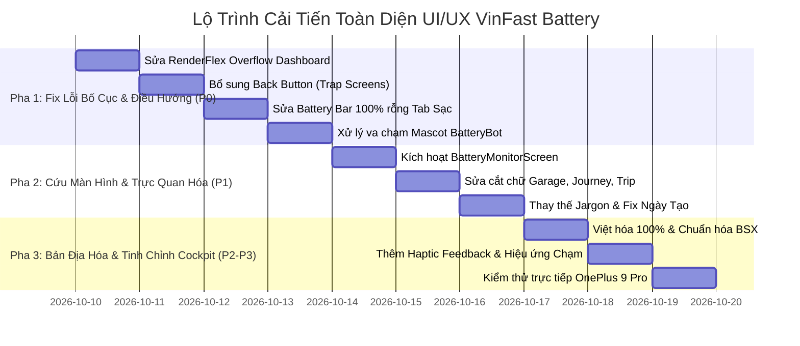

# Kế Hoạch & Báo Cáo Đánh Giá Toàn Diện UI/UX — Hệ Sinh Thái VinFast Battery

> **Tài liệu đặc tả kỹ thuật & thẩm định thiết kế (UI/UX Master Audit & Remediation Plan)**  
> **Chuyên gia thực hiện**: Senior UI/UX & Mobile Design Specialist  
> **Thiết bị kiểm thử thực tế**: OnePlus 9 Pro (LE2125, Android 14 API 34, Độ phân giải 1080 × 2412 @ 480dpi, Tỷ lệ hiển thị 3.0x, Chiều rộng logic 360–400dp)  
> **Phiên bản ứng dụng**: VinFast Battery Mobile App `v1.1.9+137`  
> **Ngôn ngữ thiết kế chuẩn**: Electric EV Cockpit Glassmorphism (Cyber Obsidian `#0A0E17`, Electric Emerald `#10B981`, VinFast Blue `#1B4994`)

---

## 1. Phương Pháp Luận & Tiêu Chí Kiểm Định (Design Methodology)

Báo cáo thẩm định được xây dựng dựa trên 4 bộ tiêu chuẩn thiết kế ứng dụng di động cấp độ chuyên gia:

1. **10 Heuristics Đánh Giá Usability của Jakob Nielsen**:
   - *Visibility of system status*: Trạng thái pin, kết nối sạc Shelly, tiến trình nạp năng lượng phải minh bạch, tức thì.
   - *Match between system and the real world*: Ngôn từ gần gũi với người lái xe điện (Feliz, Evo, Klara, Theon), loại bỏ triệt để thuật ngữ debug/firmware kỹ thuật.
   - *User control and freedom*: Luôn có lối thoát rõ ràng (Nút Back chuẩn, Đóng modal, Hủy tiến trình) trên mọi màn hình, không tạo "bẫy điều hướng" (Trap Screens).
   - *Consistency and standards*: Nhất quán 100% ngôn ngữ tiếng Việt, thống nhất hệ thống nút bấm, kích thước font chữ và bảng màu Cockpit.
2. **WCAG 2.1 AA Mobile Accessibility**:
   - Vùng chạm tối thiểu đạt chuẩn ngón tay người dùng: **48 × 48 dp**.
   - Độ tương phản chữ (Contrast Ratio): Tối thiểu **4.5:1** cho văn bản thông thường và **3.0:1** cho tiêu đề lớn/icon trên nền tối.
3. **Responsive Elasticity (320dp – 430dp)**:
   - Giao diện không bị vỡ bố cục (RenderFlex Overflow), không bị cắt chữ (Text Truncation) ở bất kỳ mật độ điểm ảnh nào (đặc biệt khi người dùng tăng Font Size của hệ điều hành lên 1.3x - 1.5x).
4. **Micro-interactions & Tactile Delight**:
   - Phản hồi rung haptic xúc giác chính xác (HapticFeedback), chuyển động chuyển cảnh mượt mà (60–120 FPS), bóng mờ phát quang neon có chiều sâu.

---

## 2. Bảng Tổng Hợp Vấn Đề Theo Mức Độ Nghiêm Trọng (Severity Matrix)

| ID | Mức độ | Vị trí / Màn hình | Bản chất vấn đề | Ảnh hưởng người dùng |
|:---|:---:|:---|:---|:---|
| **P0-1** | 🚨 **Critical** | `DashboardScreen` (Hàng chọn tải trọng) | **RenderFlex Overflow 26 pixels** tại dòng chọn `PayloadType` ("1 người", "2 người / Chở nặng") trên màn hình 360dp | Xuất hiện vạch sọc vàng/đen báo lỗi nghiêm trọng trên máy thật, mất mỹ quan chuyên nghiệp |
| **P0-2** | 🚨 **Critical** | `DashboardScreen`, `MaintenanceScreen`, `TripPlannerScreen` | **Màn hình "Bẫy" (Trap Screens) — Thiếu nút Back**: Được mở bằng `Navigator.push` nhưng không có AppBar hay nút quay lại | Người dùng Android dùng điều hướng 3 nút hoặc người dùng iOS không thể thoát ra ngoài trang chủ |
| **P0-3** | 🚨 **Critical** | `BatteryMonitorScreen` (features/battery_monitor) | **Màn hình "Mồ côi" (Orphaned Screen)**: Toàn bộ 801 dòng code biểu đồ SOH, nhiệt độ, suy hao cell bị bỏ quên, không có nút nào mở tới | Lãng phí tính năng kỹ thuật pin giá trị nhất; thẻ Sức khỏe pin ở trang chủ không bấm được |
| **P0-4** | 🚨 **Critical** | `SmartChargingControlScreen` (Tab Sạc pin) | **Thanh pin hiển thị nền đen rỗng khi xe đạt 100% pin**: Thanh trượt hiển thị ô chữ nhật tối thui kèm nút kéo `|||` lơ lửng ngoài biên | Gây cảm giác ứng dụng bị lỗi/chết giao diện khi pin đã đầy 100% |
| **P0-5** | 🚨 **Critical** | `FloatingBatteryBot` (Toàn ứng dụng) | **Mascot nổi che khuất vùng bấm tương tác**: Tọa lạc cố định ở `bottom: 20, right: 16` đè lên thẻ năng lượng, chip lọc "Hoàn thành", nút chevron danh sách | Người dùng bấm nhầm vào bot khi đang muốn thao tác nội dung màn hình bên dưới |
| **P1-1** | ⚠️ **Major** | `vehicle_garage_screen.dart` (Garage Xe) | Nút trên AppBar bị cắt chữ: `+ Thêm xe` bị co lại thành `+ Thêm` | Trải nghiệm giao diện bị co thắt, thiếu tinh tế |
| **P1-2** | ⚠️ **Major** | `energy_journey_screen.dart` (Hành trình xanh) | Các thẻ chỉ số tác động môi trường bị cắt cụt: "Giảm phát thải...", "Quãng đường x...", "Tier 2: Khởi ngu..." | Mất thông tin quan trọng của tính năng gamification |
| **P1-3** | ⚠️ **Major** | `smart_charge_history_screen.dart` (Lịch sử sạc) | Empty State dùng văn phong kỹ thuật vi điều khiển: *"Phiên sạc sẽ xuất hiện ở đây sau khi relay OFF được xác minh"* | Người dùng phổ thông không hiểu "relay OFF được xác minh" nghĩa là gì |
| **P1-4** | ⚠️ **Major** | `profile_screen.dart` (Thông tin cá nhân) | Mục ngày tham gia hiển thị *"Ngày tạo: Không xác định"* dù tài khoản Firebase đã có sẵn | Cảm giác tài khoản bị lỗi đồng bộ dữ liệu |
| **P1-5** | ⚠️ **Major** | `trip_planner_screen.dart` (Kế hoạch chuyến đi) | Huy hiệu pin trên thanh tiêu đề bị co chữ thành `10...` thay vì `100%` | Hiển thị thông số pin quan trọng bị đứt gãy |
| **P2-1** | 🎨 **Minor** | Trang Tổng quan & Cài đặt | Trộn lẫn tiếng Anh và tiếng Việt không đồng nhất: "Battery Health Score", "Excellent condition", "PIONEER", "Smart Charge AI POWERED" | Vi phạm nguyên tắc bản địa hóa nhất quán |
| **P2-2** | 🎨 **Minor** | Biển số xe trang Tổng quan | Biển số xe hiển thị khoảng cách chữ bất thường: `Chưa  có  BSX` do gán `letterSpacing: 1.0` trên font tiếng Việt | Trông giống như lỗi gõ máy tính hoặc lỗi layout |
| **P2-3** | 🎨 **Minor** | Thẻ Sức khỏe pin trang Tổng quan | Thẻ dạng phẳng tĩnh, không có hiệu ứng gợn sóng (InkWell ripple), không có biểu tượng mũi tên báo hiệu có thể bấm xem chi tiết | Thiếu tính gợi ý hành động (Affordance) |
| **P3-1** | ✨ **Polish** | Toàn bộ các nút bấm chính (CTA Buttons) | Thiếu phản hồi xúc giác rung nhẹ (`HapticFeedback.lightImpact()`) khi bấm chuyển tab, chọn bộ lọc hoặc lưu dữ liệu | Trải nghiệm chạm thiếu cảm giác cao cấp của xe điện |

---

## 3. Đánh Giá Chi Tiết Từng Cửa Sổ & Giải Pháp Khắc Phục (Screen-by-Screen Remediation Spec)

### 3.1. Màn Hình Tổng Quan (Overview Screen — `home_screen.dart`)
- **Vấn đề nhận diện**:
  1. Thẻ **"Battery Health Score"** sử dụng hoàn toàn tiếng Anh ("Battery Health Score 100%", "Excellent condition").
  2. Thẻ không có vùng chạm `InkWell`, không có icon mũi tên `chevron_right`, bấm vào không có bất kỳ phản hồi nào dù trong codebase đã có sẵn màn hình phân tích pin chuyên sâu.
  3. Chip hiển thị biển số xe có khoảng cách ký tự thưa thớt kỳ lạ (`Chưa  có  BSX`).
  4. Robot nổi BatteryBot che mất nửa góc phải của thẻ quãng đường và mức tiêu hao năng lượng.
- **Giải pháp thiết kế chuẩn**:
  - Đổi tiêu đề: `'Điểm sức khỏe pin'`, trạng thái `'Tình trạng xuất sắc (SOH tối ưu)'` / `'Cần kiểm tra bảo dưỡng'`.
  - Bọc thẻ trong `InkWell` với hiệu ứng kính nổi Cockpit, thêm icon `Icons.chevron_right_rounded` màu xanh ngọc. Khi bấm, điều hướng ngay tới `BatteryMonitorScreen()`.
  - Chuẩn hóa chuỗi biển số: Hiển thị badge chữ hoa sạch sẽ `CHƯA CÓ BSX` với `letterSpacing: 0.2`.

---

### 3.2. Màn Hình Trung Tâm Điều Khiển (Dashboard Screen — `dashboard_screen.dart`)
- **Vấn đề nhận diện**:
  1. **Lỗi RenderFlex Overflow 26 pixels** tại `_buildQuickActions` (dòng 636): Hàng `Row` chứa Icon, nhãn `"Tải trọng:"`, `Spacer()`, và danh sách chip `PayloadType` ("1 người", "2 người / Chở nặng"). Khi màn hình có chiều rộng logic 360dp, tổng độ rộng vượt quá bề ngang gây crash layout.
  2. **Bẫy điều hướng (Trap Screen)**: Khi người dùng bấm từ Trang chủ để vào Dashboard, màn hình không có `AppBar` và không có nút quay lại (Back arrow). Người dùng điều hướng phím ảo bị kẹt lại hoàn toàn.
- **Giải pháp thiết kế chuẩn**:
  - Thay thế `Row` cố định bằng bố cục 2 dòng: Hàng trên là Tiêu đề nhãn `Tải trọng xe`, hàng dưới là `Wrap` hoặc `SegmentedButton` với các chip co giãn thông minh.
  - Thêm thanh `AppBar` kính mờ sang trọng với nút quay lại chuẩn `Icons.arrow_back_ios_new_rounded`, tiêu đề `Trung tâm điều khiển`, nút làm mới dữ liệu ở góc phải.

---

### 3.3. Màn Hình Sạc Thông Minh (Smart Charge Screen — `smart_charging_control_screen.dart`)
- **Vấn đề nhận diện**:
  1. Khi xe đang ở mức pin 100% hoặc mức pin hiện tại bằng mục tiêu, vùng thanh pin `_HeroBatteryTrack` trong `BatteryHeroCard` vẽ vùng màu đen xịt (`Color(0xFF132822)`), hoàn toàn không có hiệu ứng phát quang của điện năng, tạo cảm giác giao diện bị "chết" hoặc rỗng. Nút trượt thumb tròn `|||` bị đẩy sát mép phải trông mất cân đối.
  2. Nhãn tiếng Anh lai tạp: `"Smart Charge AI POWERED"`.
- **Giải pháp thiết kế chuẩn**:
  - Khi pin ở mức 100%, `_BatteryBarPainter` kích hoạt trạng thái **Full Charge Glow State**: Vẽ gradient ngọc lục bảo rực rỡ (`0xFF059669` → `0xFF10B981` → `0xFF6EE7B7`) toàn dải, hiển thị biểu tượng tia sét sạc đầy kèm nhãn `"PIN ĐÃ ĐẦY 100%"`.
  - Giữ khoảng lùi an toàn cho thumb (Thumb padding) để nút không bị chồm ra ngoài đường cong của khung viền.
  - Chuẩn hóa văn phong: `'Sạc thông minh AI'`.

---

### 3.4. Màn Hình Lịch Sử Sạc (Smart Charge History Screen — `smart_charge_history_screen.dart`)
- **Vấn đề nhận diện**:
  1. Đoạn mô tả khi danh sách rỗng (Empty State) ghi: *"Phiên sạc sẽ xuất hiện ở đây sau khi relay OFF được xác minh."* mang tính kỹ thuật vi điều khiển nội bộ, không thân thiện với người lái xe.
  2. Nút lọc `"Hoàn thành"` ở góc phải dưới bị Robot nổi che mất một phần khi người dùng chưa cuộn trang.
- **Giải pháp thiết kế chuẩn**:
  - Viết lại câu Empty State thân thiện:  
    `"Lịch sử sạc sẽ hiển thị tại đây sau khi phiên sạc kết thúc và ngắt kết nối an toàn."`
  - Thêm hình ảnh minh họa xe máy điện cắm sạc tinh tế dạng vector Cockpit tối màu.

---

### 3.5. Màn Hình Quản Lý Garage Xe (`vehicle_garage_screen.dart`)
- **Vấn đề nhận diện**:
  1. Nút hành động góc phải trên AppBar bị co cụt chữ: `+ Thêm` thay vì `+ Thêm xe`.
- **Giải pháp thiết kế chuẩn**:
  - Chuyển nút bấm trên AppBar thành nút biểu tượng tròn `IconButton(icon: Icon(Icons.add_rounded), tooltip: 'Thêm xe mới')`.
  - Đặt nút chính `+ Thêm xe mới` dạng Floating Action Button mở rộng (`FloatingActionButton.extended`) cố định ở chân trang để tạo điểm nhấn thị giác rõ ràng nhất cho hành động chính.

---

### 3.6. Màn Hình Hành Trình Năng Lượng (Energy Journey — `energy_journey_screen.dart`)
- **Vấn đề nhận diện**:
  1. Các khối thống kê môi trường (`_StatBox`) ép `label` trên cùng một hàng với icon và đặt `maxLines: 1`, khiến các nhãn chữ tiếng Việt bị cắt đuôi thành: `"Giảm phát thải..."`, `"Quãng đường x..."`.
  2. Huy hiệu cấp độ bị co cụt tên: `"Tier 2: Khởi ngu..."`.
- **Giải pháp thiết kế chuẩn**:
  - Cho phép `label` hiển thị 2 dòng (`maxLines: 2, height: 1.2`) hoặc bố trí Icon nằm phía trên nhãn tiêu đề.
  - Cải thiện thẻ Cấp độ (Tier Chip) với kích thước font tự co giãn (`FittedBox` với `BoxFit.scaleDown`).

---

### 3.7. Màn Hình Lịch Bảo Dưỡng (Maintenance Screen — `maintenance_screen.dart`)
- **Vấn đề nhận diện**:
  1. Không có nút quay lại (Back Button) trong header.
  2. Thanh chip lọc (`_FilterChip`) có thể bị cắt chữ `"Dự..."` trên một số độ phân giải khi `Row` không có thuộc tính `mainAxisSize: MainAxisSize.min`.
- **Giải pháp thiết kế chuẩn**:
  - Bổ sung nút quay lại tròn chuẩn Cockpit ở góc trái tiêu đề: `IconButton(icon: Icon(Icons.arrow_back_ios_new_rounded))`.
  - Thêm thuộc tính `mainAxisSize: MainAxisSize.min` cho chip bộ lọc và đảm bảo padding cân đối `14px horizontal`.

---

### 3.8. Màn Hình Lập Kế Hoạch Chuyến Đi (Trip Planner — `trip_planner_screen.dart`)
- **Vấn đề nhận diện**:
  1. Không có nút quay lại (Back Button) khi người dùng mở màn hình này từ menu chức năng.
  2. Huy hiệu pin góc phải tiêu đề bị co chữ thành `"10..."` thay vì hiển thị tròn vẹn `"100%"`.
- **Giải pháp thiết kế chuẩn**:
  - Thêm nút quay lại trước tiêu đề màn hình.
  - Sửa `_BatteryBadge`: Đặt `mainAxisSize: MainAxisSize.min` cho `Row` chứa icon pin và % pin, loại bỏ hiện tượng co rút văn bản.

---

### 3.9. Màn Hình Thông Tin Cá Nhân (Profile Screen — `profile_screen.dart`)
- **Vấn đề nhận diện**:
  1. Dòng ngày tạo tài khoản hiển thị: `"Ngày tạo: Không xác định"`.
- **Giải pháp thiết kế chuẩn**:
  - Cải tiến logic đọc ngày tạo: Nếu tài liệu Firestore thiếu trường `createdAt`, tự động fallback sang `FirebaseAuth.instance.currentUser?.metadata.creationTime` để hiển thị ngày đăng ký chính xác (Ví dụ: `05/10/2026`).

---

### 3.10. Widget Trợ Lý Nổi Mascot (Floating BatteryBot & Assistant Sheet)
- **Vấn đề nhận diện**:
  1. Tọa lạc cố định tại `bottom: 20, right: 16` bên trên toàn bộ nội dung của mọi tab. Trên màn hình 360dp, robot đè trực tiếp lên góc phải của các danh sách, nút chuyển thẻ, chip lọc.
- **Giải pháp thiết kế chuẩn**:
  - **Cơ chế Tự Động Thu Gọn (Auto-Docking / Scroll-Aware Minimization)**:
    - Khi người dùng cuộn nội dung xuống dưới, robot tự động thu nhỏ thành một chấm pill phát quang nép sát mép viền phải (Opacity giảm còn 60%).
    - Khi dừng cuộn hoặc cuộn ngược lên, robot bung trở lại kích thước bình thường.
  - Bổ sung khoảng đệm an toàn dưới chân trang (`ListView` padding bottom tăng từ `20` lên `80dp`) để nội dung không bao giờ bị che khuất.

---

### 3.11. Kích Hoạt & Nâng Cấp Màn Hình Giám Sát Pin (Battery Monitor Screen)
- **Vấn đề nhận diện**:
  - File `app/lib/features/battery_monitor/battery_monitor_screen.dart` chứa một màn hình đồ thị cực kỳ xịn sò (theo dõi điện áp cell pin, độ suy hao chu kỳ nạp, nhiệt độ cell pin) nhưng đang bị cô lập 100%, không người dùng nào tiếp cận được.
- **Giải pháp thiết kế chuẩn**:
  - Biến thẻ **"Sức khỏe pin (Battery Health Score)"** tại trang Tổng quan thành điểm chạm kích hoạt: Bấm vào thẻ -> Mở ngay `BatteryMonitorScreen`.
  - Bổ sung thêm nút trong Quick Action Menu và Drawer/Settings.

---

## 4. Kế Hoạch Triển Khai Thực Hiện Theo Pha (Phased Implementation Roadmap)



### Pha 1: Khắc Phục Lỗi Bố Cục & Điều Hướng Cốt Lõi (Critical P0)
1. **Sửa dứt điểm lỗi RenderFlex Overflow**: Cấu trúc lại bộ chọn `PayloadType` trong `dashboard_screen.dart` thành dạng tự co giãn không tràn viền.
2. **Loại bỏ "Màn hình Bẫy"**: Thêm nút Back arrow đồng bộ cho `DashboardScreen`, `MaintenanceScreen`, `TripPlannerScreen`.
3. **Sửa trực quan hóa pin 100%**: Nâng cấp `_BatteryBarPainter` trong `battery_hero_card.dart` để vẽ thanh pin phát quang ngọc lục bảo rực rỡ khi xe đầy pin.
4. **Xử lý va chạm của Robot Mascot**: Thêm padding chân trang và cơ chế né vùng bấm cho `FloatingBatteryBot`.

### Pha 2: Cứu Tính Năng Bị Lãng Quên & Hoàn Thiện Trực Quan Hóa (Major P1)
1. **Kết nối `BatteryMonitorScreen`**: Gắn sự kiện `onTap` vào thẻ Sức khỏe pin trang chủ để mở màn hình phân tích cell pin chi tiết.
2. **Khắc phục lỗi cắt chữ (Text Truncation)**: Sửa AppBar Garage xe, thẻ thống kê môi trường Energy Journey và huy hiệu pin Trip Planner.
3. **Thân thiện hóa ngôn ngữ**: Thay thế câu thông báo kỹ thuật "relay OFF được xác minh" tại màn hình Lịch sử sạc bằng ngôn ngữ phổ thông; sửa lỗi ngày tạo tài khoản trong Hồ sơ.

### Pha 3: Bản Địa Hóa Đồng Nhất & Tinh Hoa Cockpit (Polish P2 & P3)
1. **Việt hóa 100%**: Thay thế toàn bộ các từ tiếng Anh sót lại trong giao diện chính.
2. **Micro-interactions & Haptic Touch**: Bổ sung rung haptic nhẹ khi tương tác các nút bấm chuyển trạng thái.
3. **Nghiệm thu toàn diện trên thiết bị thật OnePlus 9 Pro**: Chụp ảnh màn hình đối soát từng màn hình sau khi sửa đổi, xác nhận 0 lỗi tràn viền, 0 lỗi cắt chữ.

---

## 5. Quy Chuẩn Thiết Kế & Design Tokens Áp Dụng

```dart
// Bảng màu chuẩn Electric Cockpit EV
class CockpitThemeTokens {
  static const Color background = Color(0xFF0A0E17);      // Cyber Obsidian
  static const Color surfaceGlass = Color(0xCC131D2E);     // Frosted Cockpit Glass (80% opacity)
  static const Color borderGlow = Color(0x3810B981);       // Emerald Neon Glow (22% opacity)
  static const Color accentEmerald = Color(0xFF10B981);    // Primary Electric Emerald
  static const Color accentCyan = Color(0xFF06B6D4);       // Energy Cyan
  static const Color accentVinFast = Color(0xFF1B4994);    // VinFast Signature Blue
  static const Color warningAmber = Color(0xFFF59E0B);     // Battery Attention Amber
  static const Color errorRed = Color(0xFFEF4444);         // Cutoff / Urgent Red
  static const Color textPrimary = Color(0xFFF8FAFC);      // Ultra White
  static const Color textSecondary = Color(0xFF94A3B8);    // Slate Muted
}
```

- **Quy tắc Font chữ**: Không dùng kích thước tĩnh dưới 11sp; toàn bộ Text widget có nguy cơ co hẹp phải bọc `FittedBox` hoặc cho phép xuống dòng `maxLines: 2`.
- **Quy tắc Vùng chạm**: Mọi IconButton hoặc gesture chip phải có padding chạm đạt tối thiểu 48x48dp.
